# AstroLaue パイプライン処理順序フローチャート

本ドキュメントは、AstroLaue の全自動データ処理パイプラインにおける処理順序と、今回刷新された **「逆畳み込み直後の最速速報フェーズ（約1.6秒地点）」** および **「後続の完全画像・レポート出力フェーズ」** の2段階アーキテクチャを図解したものです。

---

## 1. 全体処理フローチャート (Mermaid)

```mermaid
flowchart TD
    subgraph S1 ["ステップ 1: 入力 & 前処理 (約 0.1 秒)"]
        A["新着 CSV 生データ検知 または 画面キャプチャ"] --> B["動径背景適応型減算 (Radial BG Subtraction)"]
        B --> C["極座標展開画像 (r, θ) 生成"]
    end

    subgraph S2 ["ステップ 2: 光学系 PSF 推定 & 逆畳み込み (約 1.5 秒)"]
        C --> D["非対称アンサンブル PSF 推定 (ブラー長 L_θ 同定)"]
        D --> E["Richardson-Lucy / Wiener 極座標逆畳み込み復元"]
        E --> F["先鋭化極座標画像 (polar_after) 得意な集光ピーク形成"]
    end

    subgraph S3 ["【⚡ 最速速報フェーズ (約 1.6 秒地点)】"]
        F --> G["適応型ピーク検出 (Adaptive S/N, 上位85点抽出)"]
        F --> H["露光時間最適化＆飽和解析 (先鋭化ピークスクリーニング)"]
        G --> I["結晶主軸同定 & ゴニオ補正角 (Δθx, Δθy) 逆算"]
        H --> J["推奨測定時間 & 露光比率算出"]
        I & J --> K["【即座に通知発火 (on_alignment_ready)】"]
        K --> L1["最前面 GUI HUD にリアルタイム表示"]
        K --> L2["コンソール速報 & クリップボード自動転送"]
    end

    subgraph S4 ["ステップ 4: 直交復元 & 学術画像出力 (約 3〜5 秒)"]
        K -.-> M["直交座標逆変換 (1024x1024, 角度オフセット -90° 整合)"]
        M --> N["DAOStarFinder 全スポット検出 & FWHM・先鋭化率解析"]
        N --> O["物理妥当性検証 (光量保存則 Flux Ratio / 重心シフト)"]
        O --> P["学術提出用透過PNG / 16bit PNG / コントラスト最適化画像保存"]
    end

    subgraph S5 ["ステップ 5: 診断レポート & 完了 (約 3〜5 秒)"]
        P --> Q["8パネル診断レポート図 (diagnostic_report.png) 作成"]
        Q --> R["結晶主軸アライメント診断図 (alignment_diagnostics.png) 作成"]
        R --> S["履歴永続保存 (history/) & 完了通知音"]
        S --> T["次の測定新着待ち (常駐ループへ復帰)"]
    end

    style S3 fill:#1f3d2b,stroke:#69f0ae,stroke-width:2px
    style K fill:#2e7d32,stroke:#00e676,stroke-width:3px,color:#ffffff
    style L1 fill:#0d47a1,stroke:#29b6f6,stroke-width:2px,color:#ffffff
    style L2 fill:#0d47a1,stroke:#29b6f6,stroke-width:2px,color:#ffffff
```



---

## 2. テキスト・ダイアグラム (視覚的テキストフロー)

Mermaid が表示されない環境でも確認できるよう、テキスト形式で流れを記載します。

```text
[新着 CSV または 画面キャプチャ]
   │
   ▼ (約 0.1 秒)
[動径背景適応型減算 & 極座標展開 (r, θ)]
   │
   ▼ (約 0.1 秒)
[非対称アンサンブル PSF 推定 (ブラー幅 L_θ 算出)]
   │
   ▼ (約 1.3 秒)
[極座標 Richardson-Lucy 逆畳み込み復元] ──> 【先鋭化画像 polar_after 生成】
   │
   ├───────────────────────────────────────────────────────┐
   │                                                       │
   ▼ 【⚡ 最速速報フェーズ (約 1.6 秒地点)】              │
   ├─ [適応型ピーク検出 (Adaptive S/N)]                     │ (バックグラウンド処理継続)
   │     └─> 結晶主軸同定 & ゴニオ補正角 (Δθx, Δθy)        │
   ├─ [逆畳み込み連携 露光時間最適化]                      │
   │     └─> 推奨測定時間 (例: 13s -> 16s) & 露光比率      │
   │                                                       │
   ▼                                                       ▼ (約 2.0 秒)
【最前面 GUI HUD / コンソール / クリップボードへ即時反映】  [直交座標逆変換 (1024x1024, オフセット -90°)]
                                                           │
                                                           ▼ (約 1.5 秒)
                                                        [DAOStarFinder 全150スポット検出 & 光量検証]
                                                           │
                                                           ▼ (約 2.0 秒)
                                                        [透過PNG / 16bit PNG / コントラスト最適化画像保存]
                                                           │
                                                           ▼ (約 3.0 秒)
                                                        [8パネル診断レポート (diagnostic_report.png) 作成]
                                                           │
                                                           ▼ (約 1.5 秒)
                                                        [アライメント診断図 (alignment_diagnostics.png) 作成]
                                                           │
                                                           ▼
                                                        [履歴保存 (history/) & 完了通知音]
```

---

## 3. 各処理の詳細と所要時間

| フェーズ | ステップ | 主な処理内容 | 所要時間目安 |
| :--- | :--- | :--- | :--- |
| **前処理** | ステップ 1〜6 | CSV読み込み、動径背景減算、極座標正規化展開 $(r, \theta)$ | 約 0.1 秒 |
| **光学復元** | ステップ 7〜8 | 非対称PSF同定、Richardson-Lucy逆畳み込み（30反復） | 約 1.3〜1.5 秒 |
| **⚡ 最速速報** | **ステップ 8b〜8c** | **逆畳み込み後画像からの適応型ピーク検出、主軸アライメント $(\Delta\theta_x, \Delta\theta_y)$、推奨測定時間算定、最前面HUD通知** | **約 0.05 秒<br>（累計 約 1.6 秒）** |
| **画像復元** | ステップ 9 | 直交座標逆変換（1024x1024、装置GUI整合 $-90^\circ$ オフセット） | 約 0.5〜1.0 秒 |
| **物理解析** | ステップ 10〜12 | DAOStarFinder 150スポット検出、先鋭化率・FWHM、光量保存則・残差RMSE検証 | 約 1.5 秒 |
| **画像出力** | ステップ 13 | 学術提出用透過PNG、16bit PNG、コントラスト最適化画像保存 | 約 1.5〜2.0 秒 |
| **レポート** | ステップ 13b〜14 | 8パネル総合診断レポート描画、アライメント診断図描画、履歴永続保存 | 約 3.0〜4.5 秒 |
| **合計** | 全工程完了 | フル解析完了・完了通知音 | **約 10〜12 秒** |

---

### 最適化のポイント
- **「待ち時間ゼロ」の実現**:
  ユーザーがゴニオメーターを動かすために必要な **補正角度 $(\Delta\theta_x, \Delta\theta_y)$** と **推奨測定時間** は、重い画像保存やグラフ作成を待たずに **測定完了後わずか約1.6秒で最前面HUDに即座に表示** されます。
- **弱強度データの救済**:
  逆畳み込み前の生データではブラーとノイズに埋もれていた微弱ピークが、Richardson-Lucy復元により急峻に集光された状態（`polar_after`）で適応型S/N探索を行うため、短時間露光時でも正確な判定が保証されます。
